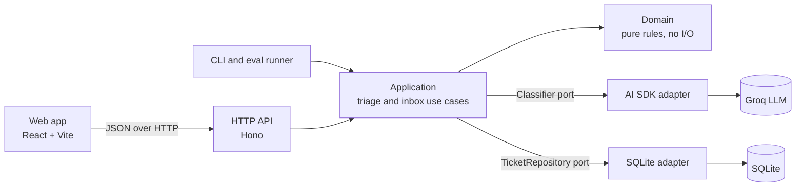
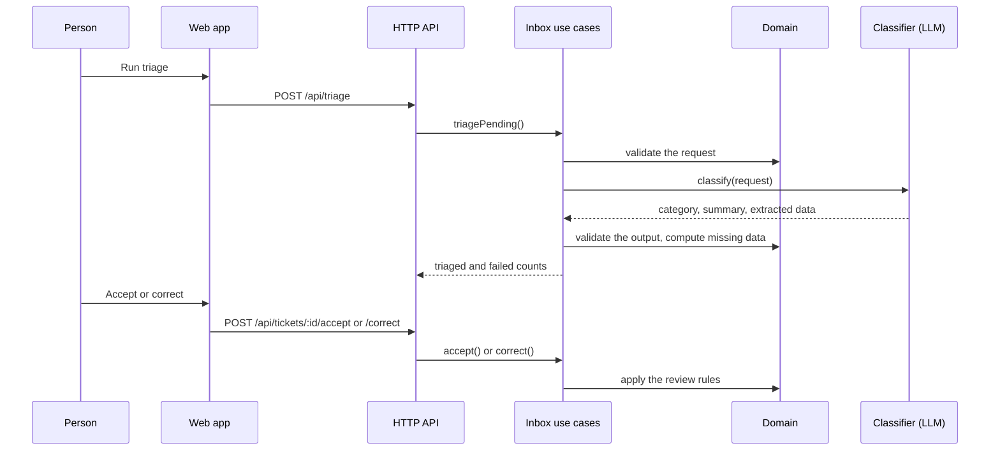
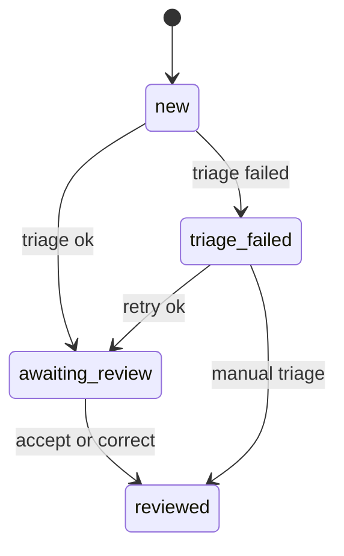

# Architecture

InboxOps is a modular monolith organized as ports and adapters. Business rules live in a pure domain layer; AI, storage and HTTP are adapters that can be replaced without touching those rules.

## Components

| Layer | Folder | Responsibility | Depends on |
|---|---|---|---|
| Domain | `src/domain/` | Requests, categories, suggestions, tickets, review rules, review stats | nothing |
| Application | `src/application/` | Use cases (`triageRequest`, `createInbox`) and the ports they need | domain |
| Adapters | `src/adapters/` | AI SDK classifier, Groq model setup, SQLite and in-memory repositories | application, domain |
| HTTP | `src/http/` | Input shape validation, status codes, static web app | application, domain |
| Composition roots | `src/main.ts`, `src/server.ts`, `src/evaluation/run-eval.ts` | Pick the provider and storage, wire everything | all of the above |
| Web | `web/` | Review inbox UI; imports domain types and pure functions | domain (types and pure functions) |

Only the composition roots know that the provider is Groq and the storage is SQLite. See [ADR 0002](decisions/0002-ports-and-adapters.md).

## Triage flow

1. An invalid request is rejected before the model is called, so it costs nothing.
2. The classifier only extracts: category, summary and the data the customer wrote.
3. The domain validates that output and decides what is missing. See [ADR 0001](decisions/0001-model-extracts-domain-decides.md).
4. A person reviews every suggestion; nothing is sent or changed automatically. See [ADR 0004](decisions/0004-human-in-the-loop.md).

## Domain rules

| Rule | Where |
|---|---|
| A request needs an id and a non-empty body of at most 4000 characters | `src/domain/support-request.ts` |
| Categories are `shipping`, `billing`, `returns` and `other` | `src/domain/category.ts` |
| A suggestion needs a known category and a summary of at most 280 characters | `src/domain/triage-suggestion.ts` |
| Shipping and billing need an order number; returns need an order number and a reason; blank values count as missing | `src/domain/triage-suggestion.ts` |
| Acceptance rate is accepted / (accepted + corrected); manual triage is left out | `src/domain/review-stats.ts` |

Validation returns a `Result` with an error code instead of throwing, because invalid input is expected, not exceptional.

## Ticket lifecycle

A `Ticket` is a discriminated union on `status`: each status carries exactly its data (`suggestion`, `triageError`, `review`), so states such as "reviewed without a review" cannot be represented.

| Rule | Where |
|---|---|
| Only `new` and `triage_failed` tickets can be triaged; a failed ticket can be retried | `src/domain/ticket.ts` |
| Only `awaiting_review` tickets can be accepted | `src/domain/ticket.ts` |
| `awaiting_review` and `triage_failed` tickets can be corrected; a correction of a failed triage is recorded as `manual` | `src/domain/ticket.ts` |
| A correction recomputes missing data with the same rule as the model's suggestion | `src/domain/ticket.ts` |
| Adding a request whose id already exists is rejected as `duplicate_id` | `src/application/inbox.ts` |

## AI adapter

`src/adapters/ai-sdk-classifier.ts` implements the `Classifier` port with the AI SDK:

- Structured output validated by a Zod schema. Every field is required and nullable, because providers with strict structured output reject optional properties.
- The customer text goes in the user message, never in the instructions, and the instructions tell the model to treat it as data. This reduces prompt injection; it does not prevent it. See [ADR 0006](decisions/0006-prompt-injection-limits.md).
- Summaries are always requested in Spanish, because the support team reads Spanish.
- Error mapping: unparsable or out-of-schema answers, including Groq's HTTP 400 `json_validate_failed`, are `invalid_output`; network errors, timeouts (20 s), rate limits and other provider errors are `unavailable`.
- An optional `onError(requestId, error)` hook passes the original error to the caller, so the cause of a failure is not lost behind the error code.

| Triage error code | Meaning |
|---|---|
| `empty_id`, `empty_body`, `body_too_long` | Invalid request; the classifier was not called |
| `classifier_unavailable` | The classifier failed or threw |
| `classifier_invalid_output` | The classifier answered with output that could not be parsed or broke the schema |
| `invalid_category`, `empty_summary`, `summary_too_long` | The classifier answered, but the domain rejected the suggestion |

## Storage

`SqliteTicketRepository` uses `node:sqlite`, built into Node 22 and still marked experimental. Each ticket is stored as a JSON document with `id`, `status` and `receivedAt` copied into columns. One contract test suite runs against both the SQLite and the in-memory repository. See [ADR 0005](decisions/0005-sqlite-behind-a-port.md).

## Web app

- **Shared contract.** The web app imports domain types and pure functions such as `findMissingFields` and `summarizeReviews` directly. A backend contract change breaks the web build, and the missing-data preview cannot drift from the server.
- **Typed API client.** `web/src/api.ts` only calls `/api/...` paths, enforced by type and at runtime, and turns error responses into an `ApiError` with status and code.
- **Injected dependencies.** `App` receives the API client as a prop, so component tests run without a server.
- **Server as source of truth.** After a review the UI replaces the ticket with the one the API returned.
- **CSV import.** A small RFC 4180 parser keeps commas, quotes and line breaks inside messages; files are sent in batches of 200, the API limit.

## Patterns used, and why

| Pattern | Where | Why it is here |
|---|---|---|
| Ports and adapters | `Classifier`, `TicketRepository` | Swap the provider or storage without touching rules; test with fakes |
| Dependency injection, by hand | `createTriageRequest({ classifier })`, `App({ api })` | Explicit wiring, no framework; every dependency is replaceable in tests |
| Decorator | `createMeteredClassifier` | Measure latency and tokens without changing the classifier or the use case |
| Discriminated union | `Ticket` | Make illegal states unrepresentable |
| Result type | `Result<T, E>` | Expected failures are values, visible in the type |
| Composition root | `main.ts`, `server.ts`, `run-eval.ts` | One place per entry point that knows the concrete choices |
| Contract tests | `ticket-repository.contract.test.ts` | Every repository implementation must behave the same |
