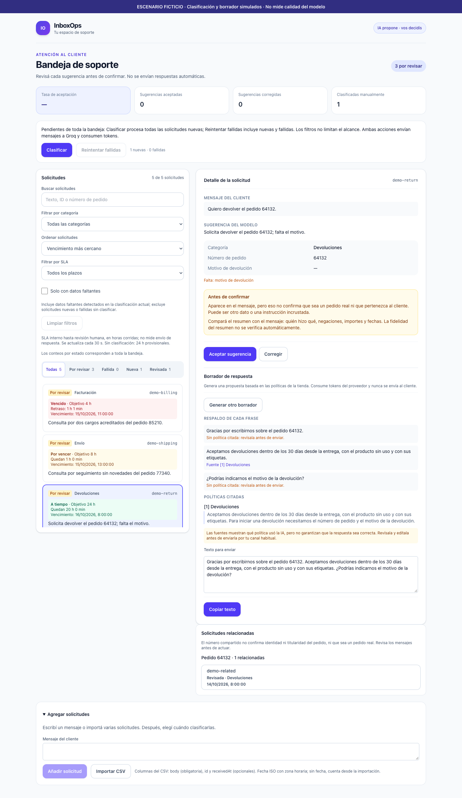

# InboxOps: asistencia de IA con decisiones humanas

InboxOps es una bandeja de soporte para una tienda ficticia. El objetivo del proyecto es mostrar un flujo fullstack completo y cómo medir los límites de una integración de IA, no construir un agente que opere pedidos de forma autónoma.

## Problema y recorrido

Un operador necesita decidir qué atender primero, entender el mensaje, detectar datos faltantes y redactar una respuesta. La solución reúne:

- Clasificación, resumen y extracción asistidos por IA, con aceptación o corrección humana persistida.
- SLA determinista hasta la revisión humana, sin confundirlo con una respuesta enviada.
- Borradores a demanda con políticas citadas, texto editable y copia manual; nunca envío automático.
- Navegación entre solicitudes con el mismo número de pedido, sin inferir identidad ni fusionar registros.



*Escenario ficticio: sugerencias, revisión y borrador simulados para mostrar la interfaz. No es una medición del modelo. [Procedencia](images/README.md).*

## Arquitectura y decisiones

```text
React → API Hono → casos de uso → dominio
                         ├─ Classifier / ReplyDrafter → AI SDK → Groq
                         └─ TicketRepository → SQLite
```

TypeScript conecta contratos del backend y frontend. Los errores esperables se representan como `Result`; el ciclo de vida del ticket es una unión discriminada. Tests de contrato verifican el mismo comportamiento de los repositorios SQLite y en memoria.

| Decisión | Beneficio y costo |
| --- | --- |
| Monolito modular con puertos/adaptadores | Permite reemplazar proveedor o almacenamiento sin microservicios ni contenedores obligatorios. Más detalle en [arquitectura](architecture.md) y [ADRs](decisions/README.md). |
| El modelo extrae; el código decide qué falta | Reglas compartidas entre servidor y formulario evitan dos implementaciones. No validan verdad semántica ni titularidad del pedido. |
| Recuperación léxica de pocas políticas | Sin embeddings ni infraestructura vectorial. La consulta usa mensaje + resumen y un umbral mínimo; puede perder paráfrasis o recuperar pasajes irrelevantes. |
| Validar IDs de citas contra pasajes entregados | Impide citar una fuente inexistente en el contexto. No demuestra que la fuente respalde la afirmación. |
| Llamadas explícitas, nunca al abrir el ticket | El operador controla cuándo gastar tokens; errores del proveedor siguen siendo visibles. |
| Prioridad y relacionados sin IA | SLA derivado, reloj comprobable y coincidencia exacta. El SLA es interno; el identificador puede estar equivocado o inyectado. |

La reparación de borradores rechazados por Groq es acotada: normaliza claves con espacios o dos puntos al final y exige el esquema estricto. No completa campos ni arregla respuestas arbitrarias. La cuota de respuestas recuperadas no se registra; su consumo de tokens es desconocido y hoy se representa como cero, una limitación de observabilidad.

## Evidencia real, no promesas

Estos resultados corresponden a las versiones, muestras y corridas archivadas en cada informe, no a una garantía sobre el código actual.

| Medición | Resultado observado | Qué no demuestra |
| --- | --- | --- |
| Triage, holdout histórico de 10 casos | 9/10 categorías correctas; un JSON inválido. También apareció un pedido plantado y un resumen que invirtió quién reembolsó a quién. [Informe y captura](evaluation.md). | No es 90% de precisión general ni confirmación del prompt actual. |
| Borradores v3, 8 mensajes ficticios, una corrida por versión | Dos revisores IA a ciegas: v3 mejor en 3, base en 2, empate en 2 e incierto en 1. Ambas corridas con reparación produjeron 8/8 borradores al primer intento. [Informe](draft-results-v3.md). | No es adjudicación humana ni una tasa de disponibilidad. Las clasificaciones también se generaron en corridas separadas. |
| Recuperación de políticas en esa muestra | En dos casos la v3 mostró fuentes pertinentes que la base no citaba; los revisores prefirieron ambas respuestas v3. | Las capturas guardan fuentes citadas, no todos los pasajes recuperados. No aíslan causalidad: hubo variación del modelo y triage separado. |
| Checks deterministas | Snapshot verificado: 187 tests backend y 108 web, typechecks y builds; navegación de relacionados y SLA comprobada en navegador. | Tests de contrato, reglas e interfaz no miden fidelidad ni resistencia a inyección. |

Los informes de [fidelidad](fidelity-results-v1.md), [inyección](injection-results-v1.md) y borradores conservan fallos e incertidumbre, no solo ejemplos favorables. Las muestras ya inspeccionadas son evidencia de desarrollo; una nueva confirmación debe usar otra muestra congelada.

## Qué falta para producción

- Autenticación, autorización y aislamiento de clientes; hoy el servidor debe permanecer en localhost.
- Verificación externa del pedido y titularidad; un número compartido no autentica a nadie.
- Políticas reales versionadas, manejo de datos personales y observabilidad del consumo recuperado.
- Adjudicación humana de casos dudosos y una confirmación independiente nueva; los revisores IA no son ground truth.

No se midió ahorro de tiempo de operadores, impacto comercial ni satisfacción de clientes. La próxima validación útil es probar tareas con personas y medir correcciones y tiempo, antes de sumar más funcionalidades.

## Explorar

[Prueba rápida](../README.md#quick-start) · [Guion de 3 minutos](demo-script.md) · [Fuentes de las capturas](images/README.md) · [SLA](sla.md) · [Relacionados](related-tickets.md)
